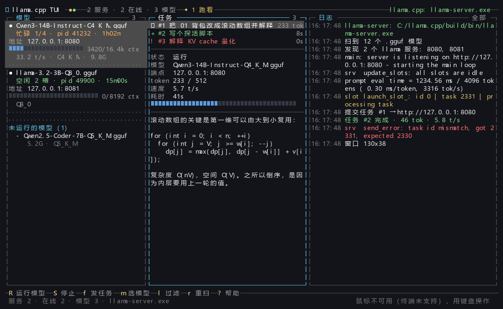
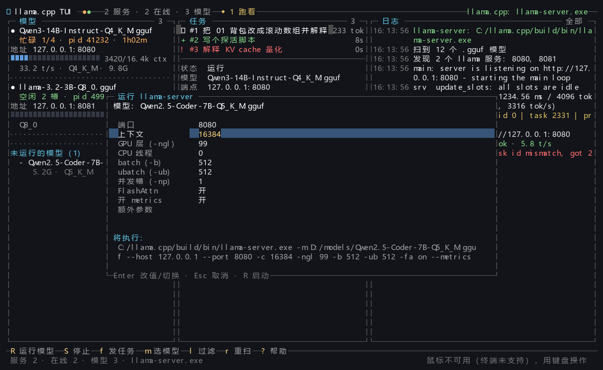

# llama.cpp TUI

## 由deepseek辅助编写

给 `llama-server` 用的终端界面，三栏显示模型、任务、日志。




界面里改运行参数、按一下就能起服务：




## 目录结构

```
llama_tui.py           主程序（单文件，全部逻辑都在这）
demo_data.py           演示假数据，改它就能改 --demo 的内容
config.example.json    配置模板，复制成 config.json 生效
tests/                 假服务 + 各类测试 + 截图脚本
docs/                  README 用的截图
.github/workflows/     CI：三个平台跑测试
```

## 构建程序

```bash
python llama_tui.py          # 启动界面
python llama_tui.py --find   # 只看发现了什么，不进界面
python llama_tui.py --demo   # 假数据，没装 llama.cpp 也能看效果
```

Windows 下也可以到列表找到文件。

> **如果双击时弹出「来自 Internet 的文件」安全警告**：这跟代码签名无关，也不是文件被标记了，而是注册表里的 `file:` 协议被映射到了 Internet 安全区域。多半是某个「系统优化」工具或安全软件改的。检查：
>
> ```
> HKCU\Software\Microsoft\Windows\CurrentVersion\Internet Settings\ZoneMap\ProtocolDefaults
>     file = 3   ← 异常，3 表示 Internet 区域
>     file = 0   ← 正常，0 表示"我的电脑"
> ```
>
> 改回 `0` 即可（改完可能要让资源管理器重启一次）。这是恢复 Windows 默认值，不影响安全。

## 在界面里直接加载模型

1. 左栏列出扫到的 `.gguf`，`j`/`k` 或 `m` 挑一个
2. 按 **`R`** 打开运行参数表单
3. `j`/`k` 选字段，`Enter` 改值（数字可直接敲，Esc 放弃本次修改）
4. 再按 **`R`** 启动 —— 表单底部实时显示将要执行的完整命令
5. 左栏出现加载进度条，起来后自动探测并并入服务列表，直接可以按 `f` 发任务
6. 按 **`S`** 停止

表单里能改：端口、上下文、GPU 层数 `-ngl`、CPU 线程、`-b`/`-ub`、并发槽 `-np`、FlashAttn、`--metrics`、额外参数。改完写回 `config.json` 的 `run` 段。

启动走参数列表（`shell=False`），所以**路径带空格也不会被拆坏**；进程工作目录设成 llama-server 所在目录，旁边的 DLL 能正常找到。

## 找到 llama.cpp 的方式

按顺序尝试：

1. `PATH` 里的 `llama-server`
2. `config.json` 里 `extra_llama_dirs` 指定的目录
3. **自己下载解压的发行版**：`桌面` / `下载` 下的 `llama`、`llama-b4567-bin-win-cuda-x64` 之类
4. **LM Studio / Jan 自带的 llama.cpp**：`~/.lmstudio/extensions/backends/` 下按版本号和加速后端挑，**但会先试跑一次**，跑不起来的（比如缺 CUDA 运行库的版本）跳过
5. 注册表 `Path`、常见安装位置、各盘浅扫 3 层

找 **模型** 则扫：`~/.lmstudio/models`（含 `<厂商>/<仓库>/xxx.gguf` 这种深层结构）、`~/.ollama/models`、`~/.cache/llama.cpp`、`~/.modelscope`、`~/models`、`~/Downloads`、`~/Desktop`、`C:/models`、`D:/models`，以及脚本所在目录。

模型文件按大小倒序排列，`mmproj-*.gguf`（多模态投影层，不能单独加载）会自动跳过。

找 **正在跑的服务** 是三条路一起上：llama 进程的 `--port` 参数 → 进程占用端口的 `netstat` 映射 → 直接对 `8080 8081 8000 5000 …` 做 HTTP 探测（认 `/health`＋`/props`，所以不会误判别的网站）。

> 探测可执行文件时会调用 `SetErrorMode` 抑制系统错误框，所以遇到缺 DLL 的版本只会安静地判为不可用，不会弹出「找不到 cublas64_12.dll」那种窗口。

扫不到就手动告诉它，复制一份配置：

```bat
copy config.example.json config.json
```

```json
{
  "extra_llama_dirs": ["D:\\llama.cpp\\build\\bin\\Release"],
  "extra_model_dirs": ["D:\\models"]
}
```

## 按键

| 键 | 作用 |
| --- | --- |
| **`R`** | **选中模型后按 R：改运行参数并直接加载启动 llama-server** |
| **`S`** | **停止由本程序启动的 llama-server** |
| `f` | 写 prompt 发给当前模型，流式接收 |
| `j` / `k` | 选任务，下半区显示该任务的输出 |
| `m` | 从模型列表挑一个 |
| `n` / `d` | 登记 / 删除模型（写进 config.json） |
| `v` | 后端详情：模型、上下文、命令行、原始 `/props` |
| `T` | 发一次 1-token 推理，确认服务真能算 |
| `l` | 日志过滤：全部 / 任务 / 警告错误 / 后端 / 发现 / TUI |
| `PgUp` `PgDn` `Esc` | 翻日志 / 回到底部 |
| `空格` | 冻结日志滚动 |
| `x` / `e` | 取消任务 / 导出任务到 `tasks/` |
| `r` | 重扫程序、模型、进程、服务 |
| `?` | 帮助 |
| `q` | 退出 |

## 鼠标

Windows 下鼠标事件有**两条来源**，程序两条都接：

1. **VT 转义序列**（Windows Terminal / ConPTY 等）—— 启动时主动发送 `ESC[?1000h ESC[?1002h ESC[?1006h` 请求。终端不会主动送鼠标事件，不请求就永远收不到。
2. **Win32 `MOUSE_EVENT` 记录**（老式 conhost）—— 同时监听，滚轮增量按高 16 位有符号解析。

| 操作 | 效果 |
| --- | --- |
| 点任务行 / 模型行 | 直接选中 |
| 点底栏按钮 | 等同按对应键（`R 运行模型` / `S 停止` / `f 发任务` / `m 选模型` / `l 过滤` / `r 重扫` / `? 帮助`） |
| 日志区滚轮 | 上下翻，自动冻结滚动；`Esc` 回到底部 |
| 日志区拖选 | 松开即复制到剪贴板（Win32 剪贴板 + OSC52 兜底） |

鼠标不灵时先跑 `python llama_tui.py --selftest`，看「鼠标」那两行：`VT 解析: OK` 说明程序侧正常，问题在终端没送事件过来。

## 演示/自测模式

假数据全在 `demo_data.py` 里，改它就能改预览内容，不碰主程序：

```python
import llama_tui, demo_data

tui = demo_data.make(llama_tui.load_config(None))   # 装好假数据的界面
tui.run()
```

`BACKENDS` / `MODELS` / `TASKS` / `LOGS` 四张表都是纯数据描述，改起来不用看渲染代码。主程序只在 `--demo`、`--dump-frame --demo` 时才 import 这个文件，正常运行不加载。

## 自检 / 联调

```bash
python llama_tui.py --selftest      # 检查终端、鼠标链路、发现能力、渲染
python llama_tui.py --dump-frame    # 打一帧纯文本，排查布局
```

测试（都不需要真的 llama.cpp）：

```bash
python tests/fake_server.py         # 假 llama-server，默认 18080，另开一个终端跑
python tests/test_integration.py    # 对着假服务跑端到端：探测 / 流式 / 渲染
python tests/test_smoke.py          # 无窗口冒烟：主循环、按键、弹窗、窄窗口
python tests/test_keys.py           # Windows 按键解码（Enter/Esc/方向键/Ctrl+C）
python tests/test_vt_mouse.py       # VT 鼠标序列解析（SGR/X10/滚轮/分片/混流）
python tests/test_input_struct.py   # Win32 INPUT_RECORD 结构布局与滚轮高 16 位
python tests/test_mouse_logs.py     # 日志折行 + 鼠标点击/滚轮/拖选复制
python tests/test_run_flow.py       # 选模型 → 改参数 → 启动 → 就绪 → 停止（真进程真端口）
```

`tests/render_preview.py` 能把界面渲染成 PNG（需要 Pillow，只是做图用，不是运行依赖）。加第三个参数 `run` 导运行表单的图。

## 已知限制

- **Windows 控制台**：需要 Windows 10 及以上（要 ANSI 转义支持）。程序会自动打开 VT 处理并把代码页切到 UTF-8；实在不支持的会退到 Win32 API 逐格写。
- **进程发现**：Windows 上优先用 WMI 拿命令行；如果 WMI 被策略禁用（部分加固环境会），会降级到 `Get-Process`，此时拿不到命令行，只能靠 `netstat` 端口和直接探测来定位服务。
- **`f` 输入框**只管敲英文和数字；中文建议在别处打好再粘贴。
- 任务栏的 token 数是按字符估算的（中文约 0.7 token/字），服务返回 `usage` 时才用真实值。
- 按 `S` 只会停掉**本程序启动的**进程；在别处开的 llama-server 请自己结束。
- 主要在 Windows 上开发和测试；Linux / macOS 走的是 POSIX + termios 分支，理论可用但验证较少，欢迎提 issue。

## License

MIT

